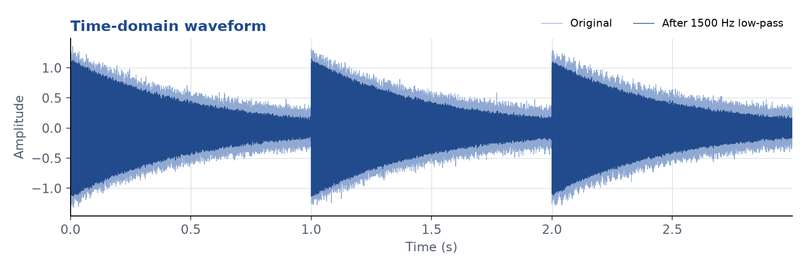
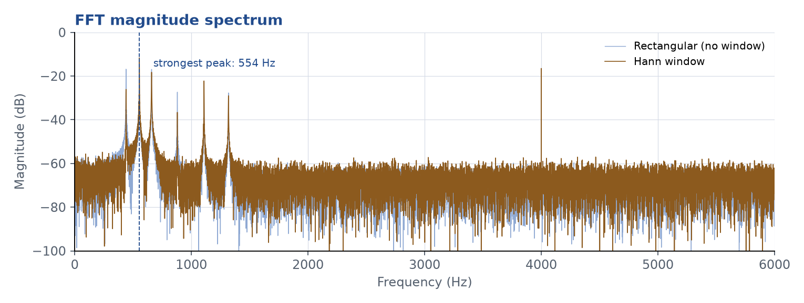
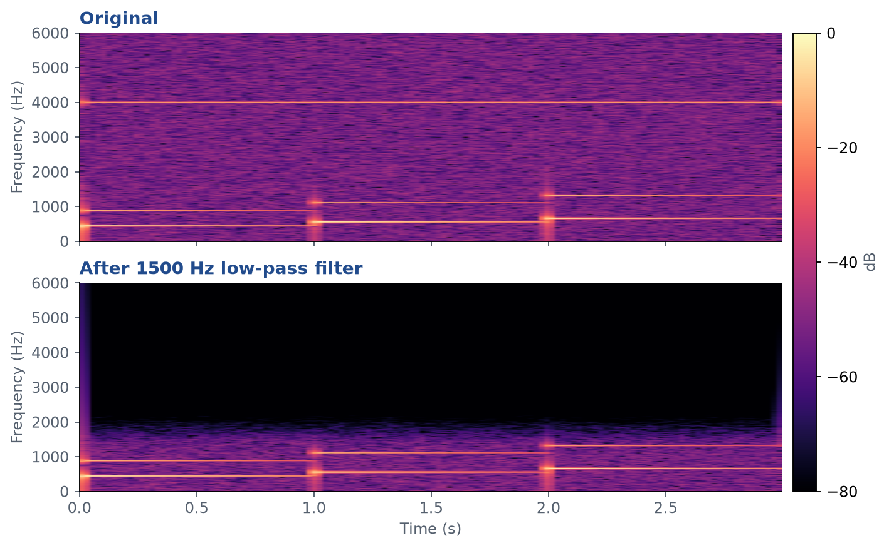
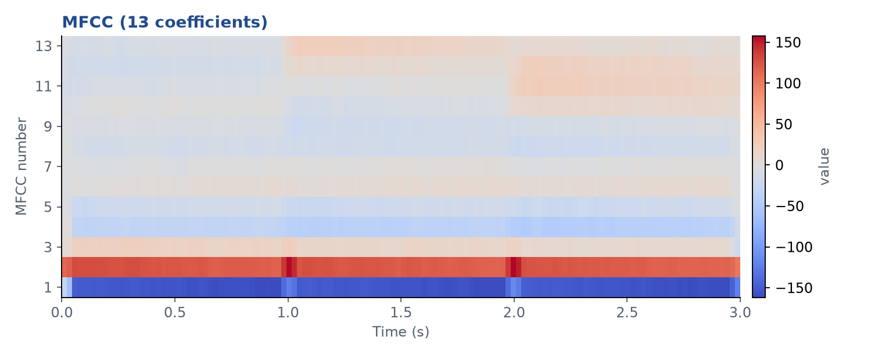

# Audio Signal Analysis and Visualization

Course project for Signals and Systems, IIITDM Kancheepuram.

The code takes an audio signal and shows what is inside it. It plots the waveform, finds the
frequencies with the FFT, cleans the signal with a low-pass filter, draws spectrograms before and
after filtering, and computes MFCCs step by step. It only needs numpy, scipy and matplotlib.

## See it working on GitHub (nothing to install)

1. Open the **Actions** tab of this repository.
2. Click **Run audio analysis** on the left, then **Run workflow**.
3. After about a minute, open the finished run. The results are shown on the run page, and the plots are saved in the
   `outputs` folder of this repository (and listed below).

Every time the code is changed, GitHub runs it again by itself. The run also checks the test signal and
prints `ALL CHECKS PASSED` when the notes and the filter behave as expected.

## Run it yourself

```
pip install -r requirements.txt
python audio_analysis.py
```

No audio file is needed. By default it builds a 3-second test signal: three notes (A4, C#5, E5),
a 4 kHz whine and some random noise.

Options:

```
python audio_analysis.py --input my_clip.wav     # use your own WAV file
python audio_analysis.py --cutoff 3000           # change the filter cutoff in Hz
python audio_analysis.py --n-fft 4096 --hop 1024 # change the spectrogram window
```

In Google Colab: upload `audio_analysis.py` and `requirements.txt`, run `!python audio_analysis.py`,
and open the images from the `outputs` folder.

## What the code does

| Step | Idea from the course | Function |
|------|----------------------|----------|
| Make or load the signal | Sampling, Nyquist | `make_test_signal`, `read_wav` |
| Frequency spectrum | DFT / FFT, windowing | `fft_spectrum`, `strongest_peaks` |
| Remove the whine | LTI systems, filtering | `lowpass` |
| Spectrogram | STFT | `stft_magnitude` |
| Features | MFCC | `mfcc` |

## Results

The files in `outputs/` are made by the code.






See `outputs/results.txt` for the numbers, and listen to `outputs/test_signal.wav` and `outputs/filtered.wav`.

## References

1. J. W. Cooley and J. W. Tukey, "An Algorithm for the Machine Calculation of Complex Fourier Series," Mathematics of Computation, 1965.
2. F. J. Harris, "On the Use of Windows for Harmonic Analysis with the Discrete Fourier Transform," Proceedings of the IEEE, 1978.
3. B. McFee et al., "librosa: Audio and Music Signal Analysis in Python," SciPy Conference, 2015.
